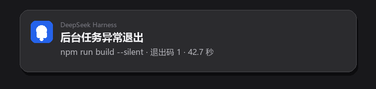
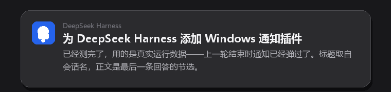
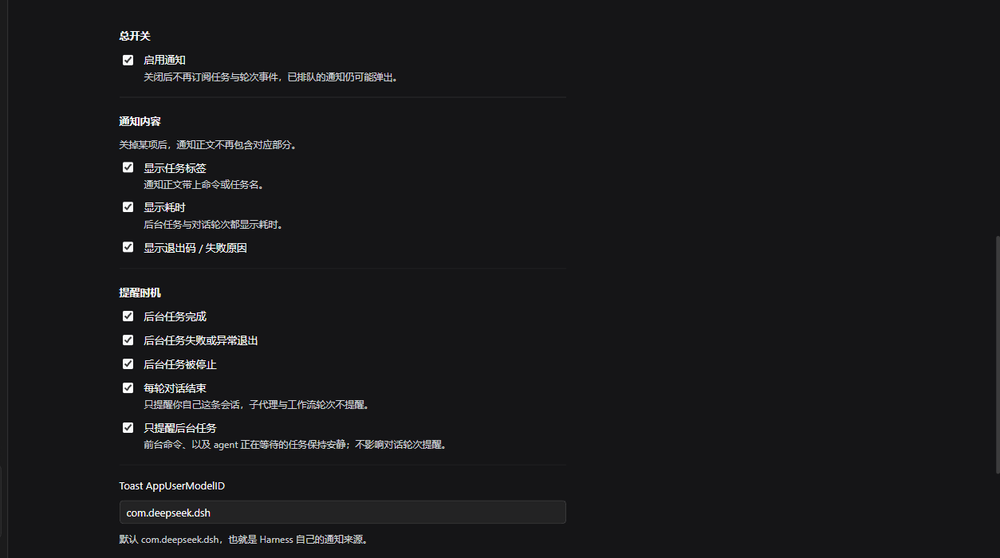
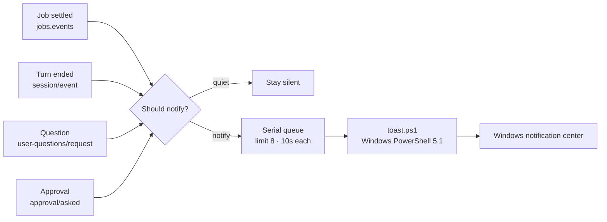

# dsh-job-notify

[简体中文](README.md) | [English](README.en.md)

**The build finishes while you are refilling your coffee.  
The agent stops on a choice while you are watching a show.**

This native Windows notification does one job: bring you back when it matters.



<sub>Real Windows notification screenshot: a background job exited non-zero. The notification text is Chinese.</sub>

---

## Four moments that call you back

| Moment | What the notification carries | Default |
|---|---|---|
| A background job completes | command, elapsed time | on |
| A background job fails / exits non-zero | command, exit code, elapsed time | on |
| The agent waits for your choice | Session name, question, question count | on |
| A tool waits for your approval | Session name, tool, reason | on |

Plus one "this turn is done" notification: Session name + an excerpt of the last answer.

---

## When it stays quiet

| Scenario | Why it is quiet |
|---|---|
| Foreground shell commands | Their caller is waiting; not unclaimed background work |
| A job an agent is awaiting with `job_output(wait: true)` | `awaited` is true |
| Cancelled / interrupted turns | The turn ended as `aborted`; nothing new to read |
| Subagent and workflow sessions | Their turns are not your conversation |
| Teardown settlements | Not finished user work |

The rule is `awaited === false`: **only work nobody is waiting for deserves a ping**. A slow foreground command stays silent.

---

## What it looks like

### Background job

The title reflects the outcome; the body carries the command, exit code, and elapsed time.

| Title | Meaning |
|---|---|
| `后台任务已完成` (completed) | Exit code 0 |
| `后台任务异常退出` (non-zero exit) | Exit code was not 0 |
| `后台任务失败` (failed) | The process never started, or the producer threw |
| `后台任务已停止` (stopped) | Killed by `job_kill` or session archive |

The body has three optional parts: label (up to 140 characters), exit code or failure reason, elapsed time.

> [!IMPORTANT]
> DSH's shell producers report a non-zero exit as `status: completed` with `detail: "exit code: N"`, not as `failed`. The plugin decides success from the exit code; otherwise a failed build would be announced as "completed".

### Conversation turn



<sub>Real screenshot: the title is the Session name; the body is an excerpt of the last answer.</sub>

- **Title**: the Session title, falling back to the workspace folder name
- **Body**: an excerpt of the last assistant answer, with Markdown stripped
- **Duration**: wall-clock time from `turn/start` to `turn/end`
- **Skipped**: cancelled/interrupted turns; subagent sessions (`origin: "subagent"`)

### A decision is needed

- **需要你选择** (answer needed): a blocked `ask_user_question`. The body carries the Session name, the first question, and the batch count.
- **需要你批准** (approval needed): a tool call waiting for approval. The body carries the Session name, tool name, and reason.

The plugin only observes: questions arrive on the `user-questions/request` waterfall and are always delegated with `next()`; approvals are read from the `approval/asked` audit event. It never answers for you or changes the outcome.

---

## Install

| Item | Requirement |
|---|---|
| OS | Windows 10 / 11 |
| Harness | DeepSeek Harness Desktop ≥ `0.2.0-rc.1`, < `0.3.0` |
| Notifications | DeepSeek Harness allowed in Windows Settings |
| Runtime | The Node.js bundled with Harness |

```powershell
git clone https://github.com/imnotRiv3r/dsh-job-notify.git E:\dshWorkspace\dsh-job-notify
cd E:\dshWorkspace\dsh-job-notify
npm install --omit=dev --no-package-lock
```

Then in Harness: **Plugins → Add plugin → choose the local directory**.

The plugin manager writes the bundle into the profile's `dsh.profile.bundles`. The Host half activates immediately; the settings section appears after the next page load.

Verify by asking the agent to run `Start-Sleep -Seconds 5` in the background.

> The `@local` scope is only a local label; the project is not published to npm. `link:` plugins do not get dependencies installed automatically, so the directory needs its own `node_modules`.

<details>
<summary>Manual profile install</summary>

```json
{
  "dependencies": {
    "@local/dsh-job-notify": "link:E:/dshWorkspace/dsh-job-notify"
  },
  "dsh": {
    "profile": {
      "bundles": ["@deepseek-ai/dsh-base", "@deepseek-ai/dsh-web-app", "@local/dsh-job-notify"]
    }
  }
}
```

Restart Harness. The bundle's `cordis.patch.yml` inserts the `job-notify` row.

</details>

> [!NOTE]
> The plugin is linked to its directory. Do not delete or move it while installed. Host changes reload through HMR; refresh the page for the browser half.

---

## Configuration

Open **Plugins → Background job notifications**; the section renders directly in the detail page. Edits are written to the profile's `cordis.patch.yml`.



<sub>Real settings page, v1.3.0.</sub>

| Field | Default | Meaning |
|---|---|---|
| `enabled` | `true` | Master switch; off means no subscriptions |
| `notifyTurnEnd` | `true` | Notify when a conversation turn ends |
| `notifyQuestions` | `true` | Notify when the agent waits on `ask_user_question` |
| `notifyApprovals` | `true` | Notify when a tool call waits for approval |
| `onCompleted` | `true` | Notify when a background job completes |
| `onFailed` | `true` | Notify on failure or non-zero exit |
| `onKilled` | `true` | Notify when a job is stopped |
| `skipAwaited` | `true` | Only unawaited jobs; `false` also notifies foreground commands |
| `showLabel` | `true` | Show the job label |
| `showDuration` | `true` | Show elapsed time for jobs and turns |
| `showExitCode` | `true` | Show the exit code or failure reason |
| `appId` | `com.deepseek.dsh` | AppUserModelID used by the toast |

`appId` accepts letters, digits, dots, underscores, and hyphens up to 128 characters; invalid values fall back to the default.

Manual override:

```yaml
- id: job-notify
  name: "@local/dsh-job-notify"
  config:
    notifyTurnEnd: false
    showLabel: false
```

---

## How it works



- **Jobs**: subscribe to `settled`, skip `cause: 'teardown'`, honor `awaited`.
- **Turns**: only `completed`, `error`, and `max-tokens` turn reasons notify.
- **Questions / approvals**: observe only; never answer or alter the decision.
- **Delivery**: one Windows PowerShell 5.1 process per notification. The payload travels as base64 JSON so command lines stay pure ASCII. A serial queue bounds the work, and each call times out after 10 seconds.
- **AUMID**: reuses Harness's registered `com.deepseek.dsh`, so the source appears as **DeepSeek Harness**.

<details>
<summary>Why every config field is <code>.volatile()</code></summary>

The Host builds editable forms from volatile nodes only. A non-volatile field makes the whole settings section disappear silently. Every `Config` field is `.volatile()`, and `apply` reads it through `.get()`.

</details>

---

## Privacy

- No network requests, no credential reads.
- Notification text comes from local sessions: titles, answer excerpts, commands, exit codes. It becomes part of Windows notification history.
- The plugin runs a local PowerShell script with `-ExecutionPolicy Bypass`; the script only shows notifications.
- Settings edits only touch the current profile's `cordis.patch.yml`.

---

## Troubleshooting

| Symptom | Fix |
|---|---|
| No notifications at all | Allow DeepSeek Harness notifications in Windows Settings; Focus Assist / Do Not Disturb suppresses them |
| No banner while a video/game is fullscreen | Windows suppresses toasts over fullscreen apps; use `Win + N` for the notification center, or switch the player to windowed/borderless fullscreen |
| Settings section is blank | Make sure every `Config` field is `.volatile()` |
| Title shows the workspace folder | No Session title yet; it falls back to the folder name |
| No turn notifications | Check `notifyTurnEnd`; subagent and workflow sessions never notify |
| Foreground commands notify | `skipAwaited` is `false` |
| No question/approval notifications | Check `notifyQuestions` / `notifyApprovals`; subagents cannot start human interaction |
| Code changes do not apply | Host reloads via HMR; refresh the page, or restart Harness |

---

## Limitations

- Windows only; the plugin stays idle elsewhere.
- Notification text is Chinese only.
- Clicking a toast does not focus Harness (would require a COM activator).
- Toasts are plain text; Markdown is stripped, not rendered.
- Exclusive fullscreen cannot be covered; system mute cannot be bypassed.
- The settings section relies on Harness internals and may need adaptation across major versions.
- The plugin is linked to its directory; deleting it breaks the link.

---

## Development

| Path | Purpose |
|---|---|
| `index.js` | Host entry: Config, event wiring, turn and decision notifications |
| `lib/format.js` | Pure formatting and decision helpers |
| `lib/toast.js` | PowerShell runner and bounded serial queue |
| `client.js` | Browser half: settings section |
| `toast.ps1` | WinRT toast sender |
| `test/` | `node:test` unit tests |

```powershell
npm run check
npm test
```

Manual toast:

```powershell
$payload = @{ title = 'Test'; body = 'From dsh-job-notify'; appId = 'com.deepseek.dsh' } | ConvertTo-Json -Compress
$encoded = [Convert]::ToBase64String([Text.Encoding]::UTF8.GetBytes($payload))
powershell.exe -NoProfile -ExecutionPolicy Bypass -File .\toast.ps1 -PayloadBase64 $encoded
```

---

## License

[MIT](LICENSE)

<sub>Not affiliated with DeepSeek. DeepSeek Harness is a trademark of its respective owner.</sub>
