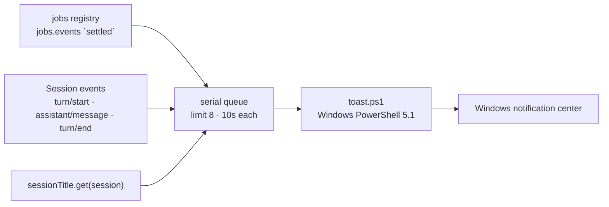

# dsh-job-notify

[简体中文](README.md) | [English](README.en.md)

**Native Windows notifications for DeepSeek Harness when a background job settles or a conversation turn ends.**

[](#limitations)
[](https://github.com/deepseek-ai/deepseek-harness)
[](LICENSE)

DeepSeek Harness models shell commands, subagents, and workflows as background jobs, but never tells you when one finishes. This plugin subscribes to the jobs registry and the session event stream, then shows a toast through Windows PowerShell 5.1's WinRT `ToastNotificationManager`. It reuses the Harness desktop AppUserModelID, so notifications appear as **DeepSeek Harness** instead of "Windows PowerShell".

> Verified against DeepSeek Harness Desktop `0.2.2-rc.1`; declares compatibility with `>=0.2.0-rc.1 <0.3.0-0`. Windows only.

---

## What it does

| Notification | Trigger | Default |
|---|---|---|
| **Background job** | An unawaited `run_in_background` shell job settles | on |
| **Conversation turn** | One turn of your own Session ends | on |

Both can be switched off independently. Foreground commands, jobs an agent is still waiting on, and cancelled turns stay quiet.

### A turn ends


- **Title**: the Session title from the Host's `sessionTitle` service, falling back to the workspace folder name
- **Body**: an excerpt (about 200 characters) of the last assistant answer, with Markdown syntax stripped
- **Duration**: wall-clock time from `turn/start` to `turn/end`
- **Skipped**: cancelled and interrupted turns; subagent sessions (`origin: "subagent"`), including workflow subtasks that run as subagents

### A background job settles


| Title | Meaning |
|---|---|
| `后台任务已完成` (completed) | Exit code 0 |
| `后台任务异常退出` (non-zero exit) | Exit code was not 0 |
| `后台任务失败` (failed) | The process never started, or the producer threw |
| `后台任务已停止` (stopped) | Killed by `job_kill` or session archive |

The body is a join of the enabled parts: label (up to 140 characters), exit code or failure reason, and elapsed time.

> [!IMPORTANT]
> DSH's shell producers report a non-zero exit as `status: completed` with `detail: "exit code: N"`, not as `failed`. The plugin therefore decides success from the exit code; otherwise a failed build would be announced as "completed".

---

## Requirements

| Item | Requirement |
|---|---|
| OS | Windows 10 / 11 |
| Harness | DeepSeek Harness Desktop `>= 0.2.0-rc.1`, `< 0.3.0` |
| Runtime | The Node.js bundled with Harness |
| Notifications | DeepSeek Harness allowed in Settings → System → Notifications |

---

## Install

> The `@local` scope is only a local label. This project is not published to npm; install it from a local directory, so no registry is involved.

1. Clone the repository and install its single runtime dependency:

   ```powershell
   git clone https://github.com/imnotRiv3r/dsh-job-notify.git E:\dshWorkspace\dsh-job-notify
   cd E:\dshWorkspace\dsh-job-notify
   npm install --omit=dev --no-package-lock
   ```

   `link:` plugins do not get dependencies installed by pnpm automatically, so the plugin directory needs its own `node_modules`. `pnpm install --prod` works too.

2. In Harness, open **Plugins → Add plugin** and choose the local directory.

3. The plugin manager writes the bundle into the profile's `dsh.profile.bundles`. The Host half activates immediately; the settings section appears on the next page load.

4. Verify by asking the agent to start a background command such as `Start-Sleep -Seconds 5`.

> [!NOTE]
> The plugin is linked to its directory. Do not delete or move it while it is installed. Host changes reload through HMR; the browser half needs a page refresh.

---

## Configuration

Open **Plugins → Background job notifications**; the settings section is rendered directly under the bundle description. Edits are written to the profile's `cordis.patch.yml`.


You can also override the row by id:

```yaml
- id: job-notify
  name: "@local/dsh-job-notify"
  config:
    notifyTurnEnd: false
    showLabel: false
```

| Field | Default | Meaning |
|---|---|---|
| `enabled` | `true` | Master switch; off means no event subscriptions |
| `notifyTurnEnd` | `true` | Notify when a conversation turn ends |
| `onCompleted` | `true` | Notify when a background job completes |
| `onFailed` | `true` | Notify on failure or non-zero exit |
| `onKilled` | `true` | Notify when a job is stopped |
| `skipAwaited` | `true` | Only notify unawaited jobs; `false` also notifies foreground commands |
| `showLabel` | `true` | Show the job label in the body |
| `showDuration` | `true` | Show elapsed time for jobs and turns |
| `showExitCode` | `true` | Show the exit code or failure reason |
| `appId` | `com.deepseek.dsh` | AppUserModelID used by the toast |

`appId` accepts letters, digits, dots, underscores, and hyphens up to 128 characters; invalid values fall back to `com.deepseek.dsh`.

---

## How it works



- **Jobs**: `ctx.jobs.events.subscribe({ owners: 'all' }, …)` handles `settled`, skips `cause: 'teardown'`, and honors `awaited`.
- **Turns**: `ctx.on('session/event', …)` records `turn/start`, caches the last assistant text, and decides on `turn/end`. Only `completed`, `error`, and `max-tokens` notify.
- **Delivery**: one Windows PowerShell 5.1 process per toast. PowerShell 7 lacks the WinRT projection required by `Windows.UI.Notifications`. The payload travels as base64 JSON so command lines stay pure ASCII and Chinese text survives the console code page.
- **AUMID**: the toast uses `com.deepseek.dsh`, which the Harness desktop already registered, so it appears as **DeepSeek Harness**.
- **Volatile config**: the Host builds editable forms from volatile nodes only. A non-volatile field would make the settings section disappear silently, so every field is `.volatile()`.

---

## Privacy and security

- No network access, no credential reads, no telemetry.
- Notification text comes from local sessions: titles, answer excerpts, commands, exit codes. It becomes part of the Windows notification history, so treat sensitive workspaces accordingly.
- The plugin runs `toast.ps1` with `-ExecutionPolicy Bypass`. The script only shows a toast; it has no network or file operations and can be audited.
- No administrator rights and no changes to system notification settings.

---

## Troubleshooting

| Symptom | Cause and fix |
|---|---|
| No notifications at all | Enable notifications for DeepSeek Harness in Windows Settings; Focus Assist / Do Not Disturb suppresses toasts |
| No banner while a video or game is fullscreen | Windows suppresses toasts over fullscreen apps; the notification usually still lands in the Action Center (`Win + N`). Settings → System → Focus Assist → Automatic rules → "When I'm using an app in full screen mode" → Off. Exclusive-fullscreen players may still cover it |
| Source shows "Windows PowerShell" | `appId` was changed to an unregistered value; restore `com.deepseek.dsh` |
| Settings section is blank | Check that every `Config` field is `.volatile()` |
| Title shows `dshWorkspace` | No session title yet; it falls back to the folder name until the first title is generated |
| Turn body says "本轮已完成" | The last assistant message had no text block (tool-only turn); this is the intended fallback |
| No turn notifications | Check `notifyTurnEnd`; subagent and workflow sessions never notify |
| Foreground commands notify | `skipAwaited` is `false` |
| Notifications are delayed | Delivery is serial and each toast may take up to 10 seconds; the queue holds at most 8 entries |
| Code changes do not apply | Host reloads through HMR; refresh the page for the client half, or restart Harness |
| `toast failed` in the log | Usually PowerShell blocked by security software, or notifications disabled by policy |

---

## Limitations

- Windows only. The plugin stays idle elsewhere instead of failing.
- Notification text is Chinese only.
- Clicking a toast does not focus the Harness window (would require a COM activator).
- Toasts are plain text; Markdown is stripped, not rendered.
- The settings section relies on Harness internals (`plugins.bundle.config`, `configForms`) and may need adaptation across major Harness versions.
- Notification history is retained by Windows, outside the plugin's control.
- The plugin is linked to its directory; deleting it breaks the link.

---

## Development

```powershell
npm run check   # node --check
npm test        # node:test
```

| Path | Purpose |
|---|---|
| `index.js` | Host entry: Config schema, event wiring, turn reporter |
| `lib/format.js` | Pure formatting and decision helpers |
| `lib/toast.js` | PowerShell runner and bounded serial queue |
| `client.js` | Browser half: settings section |
| `toast.ps1` | WinRT toast sender |
| `test/` | Unit tests with `node:test` |

Tests neither require Harness nor show real toasts: the process call is injectable and the queue is exercised with a fake runner.

---

## Publishing

See [docs/PUBLISHING.md](docs/PUBLISHING.md) for the first-time GitHub setup (repository creation, push, placeholder replacement, release tagging).

---

## License

[MIT](LICENSE)

---

<sub>Not affiliated with DeepSeek. DeepSeek Harness is a trademark of its respective owner.</sub>
