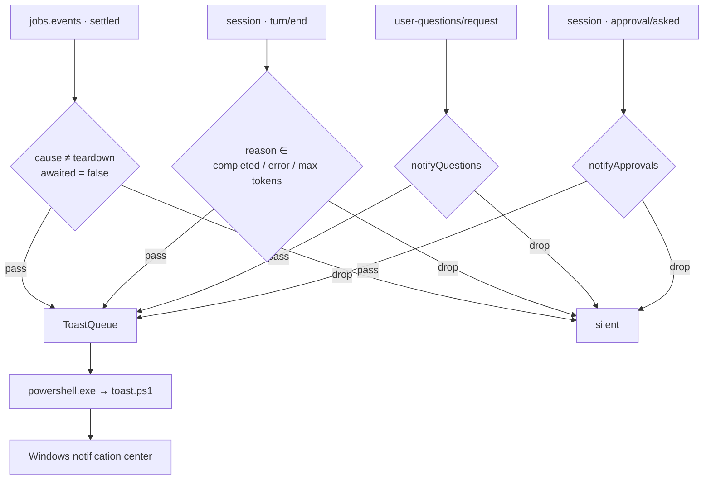

# dsh-job-notify

[English](README.md) · [简体中文](README.zh-CN.md)

[](https://www.npmjs.com/package/dsh-job-notify)
[](LICENSE)
[](#compatibility)
[](#compatibility)
[](#compatibility)
[](test/)

**Notifications for the work nobody is watching.**

A background build finishes while you are refilling your coffee. The agent stops on a
question while you are watching a show. This plugin brings you back at exactly those
moments — and stays quiet for every command you are actually waiting on.

---

## Contents

- [What you get](#what-you-get)
- [When it stays quiet](#when-it-stays-quiet)
- [What the notification looks like](#what-the-notification-looks-like)
- [Install](#install)
- [Configuration](#configuration)
- [How it works](#how-it-works)
- [Privacy](#privacy)
- [Compatibility](#compatibility)
- [Troubleshooting](#troubleshooting)
- [Limitations](#limitations)
- [Development](#development)
- [Contributing](#contributing)
- [License](#license)

---

## What you get

Six notifications, each with its own switch:

| Notification | Fires when | Default | Turn off with |
|---|---|---|---|
| Background job completed | A job nobody is waiting on exits 0 | on | `onCompleted` |
| Background job failed | Non-zero exit code, or the process never started | on | `onFailed` |
| Background job stopped | Killed by `job_kill` or a session archive | on | `onKilled` |
| Conversation turn ended | Your own turn closes as completed / error / max-tokens | on | `notifyTurnEnd` |
| An answer is needed | The agent blocks on `ask_user_question` | on | `notifyQuestions` |
| An approval is needed | A tool call waits for your approval | on | `notifyApprovals` |

Two properties matter more than the list itself:

- **It only speaks when something is unclaimed.** A slow foreground command never pings you,
  because its caller is waiting for it. Only `awaited === false` settlements count as
  background work.
- **It observes, never decides.** Question and approval notifications are read-only: the
  plugin always delegates with `next()` and cannot answer for you or change a result.

---

## When it stays quiet

| Situation | Why it is silent |
|---|---|
| Foreground shell commands | The caller is waiting; this is not unclaimed work |
| A job an agent awaits with `job_output(wait: true)` | `awaited` is `true` |
| Cancelled or interrupted turns | The turn reason is not `completed` / `error` / `max-tokens` |
| Subagent and workflow sessions | Their turns are not your conversation (`origin: "subagent"`) |
| Session teardown | `cause: "teardown"` settlements belong to unloading sessions |
| The plugin is disabled | `enabled: false` cancels every subscription |
| The Host is not Windows | The plugin logs one line and stays idle |

The single rule behind the first two rows: **only work nobody is waiting for deserves a ping.**
Set `skipAwaited: false` if you want every settlement, foreground or not.

---

## What the notification looks like

Windows renders two short text lines: a title and a body. These are real examples of the
shape each notification takes — the borders stand for the Windows banner.

**Background job completed** — title carries the outcome, body carries label and duration:

```
┌ Windows · DeepSeek Harness
│  后台任务已完成
│  npm run build · 1 分 12 秒
└ ─────────────────────────────────────────
```

**Background job exited non-zero** — the exit code goes into the body:

```
┌ Windows · DeepSeek Harness
│  后台任务异常退出
│  npm test · 退出码 1 · 4.3 秒
└ ─────────────────────────────────────────
```

**Background job failed or was stopped** — the failure reason takes the exit-code slot:

```
┌ Windows · DeepSeek Harness
│  后台任务失败
│  npm install · spawn npm ENOENT · 0.2 秒
└ ─────────────────────────────────────────
```

**Conversation turn ended** — the title is your Session's title, the body an excerpt of the
answer that closed the turn. A turn that only ran tools has no answer text, so the body falls
back to `本轮已完成` / `本轮达到输出上限`, or `本轮出错：…` when it ended in an error:

```
┌ Windows · DeepSeek Harness
│  dsh-job-notify
│  README 已重写，P1 可以提 PR 了 · 2 分 41 秒
└ ─────────────────────────────────────────
```

**An answer is needed** — the question comes first, with a batch count when there are several:

```
┌ Windows · DeepSeek Harness
│  需要你选择
│  dsh-job-notify · 先做 P1 还是 P1–P3？（共 2 个问题）
└ ─────────────────────────────────────────
```

**An approval is needed** — tool name and the reason you were given:

```
┌ Windows · DeepSeek Harness
│  需要你批准
│  dsh-job-notify · 工具：pwsh · 执行 git push
└ ─────────────────────────────────────────
```

### How the text is composed

| Kind | Title | Body |
|---|---|---|
| Job | One of the four fixed titles below | `{label} · {exit code or failure reason} · {duration}` |
| Turn | Session title → workspace folder → `DeepSeek Harness` | `{answer excerpt} · {duration}` |
| Question | `需要你选择` | `{session} · {first question}` (+ `（共 N 个问题）`) |
| Approval | `需要你批准` | `{session} · 工具：{tool} · {reason}` |

Parts are joined with ` · ` and empty parts are dropped, so turning off `showLabel` simply
removes that segment instead of leaving a gap.

### Which outcome a job reports

The title is decided by exit code first, status second:

| `job.status` | `detail` | Outcome | Title |
|---|---|---|---|
| `killed` | any | killed | `后台任务已停止` |
| `failed` | any | failed | `后台任务失败` |
| `completed` | `exit code: N`, N ≠ 0 | nonzero | `后台任务异常退出` |
| `completed` | `exit code: 0` or no exit code | completed | `后台任务已完成` |

> [!IMPORTANT]
> DSH's shell producer reports a non-zero exit as `status: completed` with
> `detail: "exit code: N"` — not as `failed`. This plugin therefore decides success from the
> **exit code**; trusting the status alone would announce a failed build as "completed".
> Both `exit code: N` and the `[exit code: N]` tool-result marker are recognised, negative
> codes included.

### Truncation and formats

| Part | Budget | Behaviour |
|---|---|---|
| Title | 80 graphemes | Falls back to `DeepSeek Harness` when empty |
| Job label | 140 graphemes | Falls back to the job kind, then `后台任务` |
| Detail, tool, reason | 90 graphemes each | Whitespace collapsed to single spaces |
| Turn excerpt | 200 graphemes | Markdown stripped before truncation |
| `appId` | 128 characters | Invalid values fall back to `com.deepseek.dsh` |

Truncation is **grapheme-safe** (an emoji is never cut in half) and appends `…`.

Durations are humanised: `4.3 秒`, `1 分 12 秒`, `1 小时 5 分`. Anything under 59.95 s keeps
one decimal; above that it rounds to whole seconds first, so 119.9 s renders as `2 分` and
never as `1 分 60 秒`.

---

## Install

### Requirements

| Item | Requirement |
|---|---|
| OS | Windows 10 / 11 |
| Client | DeepSeek Harness Desktop, or `dsh web` |
| Host | Must run on Windows — toasts are emitted by the Host process, not the browser |
| Harness | ≥ `0.2.0-rc.1`, < `0.3.0` |
| Node.js | ≥ 20, no separate install needed (Harness bundles one) |
| Notifications | **DeepSeek Harness** allowed in Windows Settings → Notifications |

### Step 1 — get the plugin

**Option A: plugin marketplace.** Install it from the plugin catalogue; the package name is
`dsh-job-notify`. It is published on npm, and `@deepseek-ai/schemastery` is supplied by Harness
as a peer dependency, so there is nothing else to install.

**Option B: a local directory.** Useful for tracking `main` or hacking on the plugin:

```powershell
git clone https://github.com/imnotRiv3r/dsh-job-notify.git E:\dshWorkspace\dsh-job-notify
cd E:\dshWorkspace\dsh-job-notify
npm install --no-package-lock
```

### Step 2 — add it to Harness

**Plugins → Add plugin → select the directory** (Option B), or install it from the market
(Option A).

The plugin manager writes the bundle into the profile's `dsh.profile.bundles`. The Host half
activates immediately; the settings section appears after the next page refresh.

Desktop and `dsh web` share the same Plugins page. In both, notifications are emitted by the
Host process, so a browser on another machine will not receive this machine's toasts.

<details>
<summary>Manual profile install</summary>

Add the dependency and the bundle to the profile's `package.json`:

```json
{
  "dependencies": {
    "dsh-job-notify": "link:E:/dshWorkspace/dsh-job-notify"
  },
  "dsh": {
    "profile": {
      "bundles": ["@deepseek-ai/dsh-base", "@deepseek-ai/dsh-web-app", "dsh-job-notify"]
    }
  }
}
```

Restart Harness. The bundle's `cordis.patch.yml` inserts the `job-notify` row.

</details>

### Step 3 — verify

Ask the agent to run something in the background, for example:

```powershell
Start-Sleep -Seconds 5
```

A toast should appear within a few seconds of the job finishing. If it does not, work through
[Troubleshooting](#troubleshooting).

> [!NOTE]
> A local install is `link:`-ed to its directory — do not delete or move it while installed.
> Code changes reload through HMR on the Host half; refresh the page for the browser half.

### Uninstall

Remove the plugin in the Plugins panel (this drops the bundle and its settings entry), then
delete the local directory if you installed one. Profile-level leftovers live in the profile's
`package.json` and `cordis.patch.yml`.

---

## Configuration

**Plugins → Background job notifications** — the section renders directly in the plugin's
detail page. Every change is written to the profile's `cordis.patch.yml` and takes effect
without a restart (the settings section itself needs a page refresh to appear the first time).

### Master switch

| Field | Default | Effect |
|---|---|---|
| `enabled` | `true` | Off cancels every subscription; queued toasts may still pop |

### What to notify

| Field | Default | Effect |
|---|---|---|
| `onCompleted` | `true` | Background job completed |
| `onFailed` | `true` | Background job failed, or exited non-zero |
| `onKilled` | `true` | Background job stopped |
| `notifyTurnEnd` | `true` | One toast per finished conversation turn |
| `notifyQuestions` | `true` | The agent is blocked on `ask_user_question` |
| `notifyApprovals` | `true` | A tool call is waiting for approval |

### The quiet rule

| Field | Default | Effect |
|---|---|---|
| `skipAwaited` | `true` | Only unawaited jobs notify. `false` also notifies foreground commands — and everything an agent is waiting on |

### What the body shows

| Field | Default | Effect |
|---|---|---|
| `showLabel` | `true` | Include the command / job label |
| `showDuration` | `true` | Include elapsed time (jobs and turns) |
| `showExitCode` | `true` | Include the exit code, or the failure reason for failed/stopped jobs |

### Advanced

| Field | Default | Effect |
|---|---|---|
| `appId` | `com.deepseek.dsh` | AppUserModelID the toast is sent under. Letters, digits, `.`, `_`, `-`; max 128 chars; anything else falls back to the default |

The default `appId` reuses the one Harness already registers, which is why notifications show
up as **DeepSeek Harness** rather than a generic PowerShell source.

### Presets

Copy one of these into the profile's `cordis.patch.yml`:

```yaml
# Only failures — the quietest useful setting
- id: job-notify
  name: "dsh-job-notify"
  config:
    onCompleted: false
    notifyTurnEnd: false

# Jobs only, no conversation noise
- id: job-notify
  name: "dsh-job-notify"
  config:
    notifyTurnEnd: false
    notifyQuestions: false
    notifyApprovals: false

# Never miss anything, foreground commands included
- id: job-notify
  name: "dsh-job-notify"
  config:
    skipAwaited: false

# Minimal text: outcome and duration only
- id: job-notify
  name: "dsh-job-notify"
  config:
    showLabel: false
    showExitCode: false
```

<details>
<summary>Why every config field has to be <code>.volatile()</code></summary>

The Host's settings service builds its editable form from **volatile nodes only**. A plain
field is filtered out silently — the result is a settings section that simply never appears,
with no error. Every field in `Config` therefore carries `.volatile()`, and `apply` reads each
one through `.get()`. Keep this property when adding fields.

</details>

---

## How it works



### Event wiring

| Source | Gate | Result |
|---|---|---|
| `jobs.events` (`owners: 'all'`, `settled`) | `cause !== 'teardown'`; outcome switch; `awaited === false` when `skipAwaited` | Job toast |
| `session/event` — `turn/start` | — | Records the turn's start time |
| `session/event` — `assistant/message` | — | Caches the last assistant text (Markdown stripped) |
| `session/event` — `turn/end` | Reason in `completed` / `error` / `max-tokens`; `origin !== 'subagent'` | Turn toast |
| `session/event` — `approval/asked` | `notifyApprovals` | Approval toast |
| `user-questions/request` waterfall | `notifyQuestions`; always `next()` | Question toast |
| `session/disposed` | — | Drops that Session's caches |

### Delivery

1. A payload is composed by pure functions in `lib/format.js` — no Node APIs, so the rules are
   unit-testable without a running Harness.
2. Payloads enter a **bounded serial queue** (`lib/toast.js`): at most **8** wait, and a full
   queue **drops the oldest** rather than growing. The newest settlements are the ones you are
   most likely to act on.
3. One toast at a time, each an independent Windows PowerShell 5.1 process — only that engine
   ships the WinRT projection `Windows.UI.Notifications` needs.
4. The payload travels as **base64 JSON** on the command line, so the line stays pure ASCII and
   Chinese text, quotes, or `%` survive regardless of the console code page.
5. The script fills the `ToastText02` template and calls `Show()` under the configured AUMID.
6. Each call has a **10 second** deadline; a wedged shell is killed and the queue moves on.
7. On plugin disposal the queue closes and drops whatever is still pending.

Failures never break the pipeline: the queue logs `toast failed: …` or `toast queue full (8);
dropped the oldest notification` and continues with the next payload.

---

## Privacy

- **No network requests**, no credential reads, no telemetry.
- Notification text comes from local sessions only: Session titles, answer excerpts, commands,
  exit codes, tool names. All of it lands in Windows notification history — assess that for
  sensitive projects.
- Sending runs a **local script** (`toast.ps1`, launched with `-ExecutionPolicy Bypass`) that
  only calls the Windows toast API; it is short enough to audit in a minute.
- Settings edits only touch the current profile's `cordis.patch.yml`.

---

## Compatibility

| Component | Supported |
|---|---|
| Windows | 10 / 11 |
| Harness | `>= 0.2.0-rc.1 < 0.3.0-0` (declared in `dsh.compatibility`) |
| Node.js | `>= 20` |
| Clients | Desktop and `dsh web` |
| Peer dependency | `@deepseek-ai/schemastery >= 3.18.0 < 4.0.0`, provided by Harness for marketplace installs |

Two consequences worth knowing before you install:

- **`dsh web` sends from the Host.** Notifications work when the Host runs on Windows and you
  are at that machine. A browser on another device receives none of them — the toast appears on
  the Host's desktop instead.
- **A bare `dsh web` deployment** without Desktop may not have `com.deepseek.dsh` registered as
  an AUMID. If toasts never appear, set `appId` to an AUMID that is registered on that machine.

---

## Troubleshooting

| Symptom | Likely cause | Fix |
|---|---|---|
| No notifications at all | Windows notifications disabled for Harness | Settings → Notifications → allow **DeepSeek Harness** |
| No banner, but the notification center has it | Focus Assist / Do Not Disturb, or a fullscreen app | Turn off Focus Assist; for fullscreen, see below |
| No banner while watching a video in fullscreen | Windows suppresses banners over fullscreen windows | Press `Win + N`; exclusive-fullscreen players can only be fixed by going borderless/windowed |
| Foreground commands notify | `skipAwaited` is `false` | Set it back to `true` |
| Background jobs never notify | `onCompleted` / `onFailed` / `onKilled` all off, or the job was awaited | Check the switches; check whether the agent waited on the job |
| No turn notifications | `notifyTurnEnd` off, or the turn was cancelled / the Session is a subagent | Check `notifyTurnEnd`; subagent and workflow turns never notify |
| No question or approval notifications | `notifyQuestions` / `notifyApprovals` off | Check both switches. Subagents cannot start human interaction at all |
| Title shows the workspace folder name | The Session has no generated title yet | Send one message; the title follows |
| Settings section is blank | A `Config` field lost `.volatile()` | Re-add `.volatile()` — see the note under [Configuration](#configuration) |
| `toast failed: …` in the log | PowerShell blocked by security software, or the deadline hit | Check the antivirus; try running `toast.ps1` manually (below) |
| Plugin does nothing at all | Host is not Windows, or `enabled` is false | Look for `job-notify: native toasts need Windows` in the log |
| `ERR_MODULE_NOT_FOUND` on startup | The Loader row's `name` does not match the package name | Use `name: "dsh-job-notify"` in the profile patch |

---

## Limitations

- **Windows only.** On other platforms the plugin loads, logs once, and stays idle.
- **Notification text is Chinese only.** Titles and bodies are fixed Chinese strings; the
  English README describes the behaviour, not the toast copy.
- **Clicking a toast does not focus Harness.** That needs a COM activator for `com.deepseek.dsh`.
- **Plain text only.** Markdown is stripped, never rendered.
- **Exclusive fullscreen cannot be covered**, and system mute cannot be bypassed.
- **The settings section depends on Harness internals** (`plugins.bundle.config`,
  `configForms`); a major Harness upgrade may need adaptation.
- **A local install is a symlink.** Deleting or moving its directory breaks the plugin.
- **Toasts belong to the Host, not the browser** — see [Compatibility](#compatibility).

---

## Development

| Path | Purpose |
|---|---|
| `index.js` | Host entry: `Config`, event wiring, turn and decision notifications |
| `lib/format.js` | Pure formatting and decision helpers — no Node APIs |
| `lib/toast.js` | PowerShell runner and bounded serial queue |
| `client.js` | Browser half: the settings section in the Plugins panel |
| `toast.ps1` | WinRT toast sender (`ToastText02` template) |
| `locale/` | Plugin-catalogue title and description (`zh`, `en`) |
| `cordis.patch.yml` | Bundle patch that inserts the `job-notify` row |
| `test/` | `node:test` suites |

```powershell
npm run check   # node --check on every source file
npm test        # node:test — 22 cases, no Harness needed
```

Tests never send a real toast: the PowerShell process call and the queue runner are injectable.
They cover formatting and truncation, outcome detection from exit codes, Markdown stripping,
the queue's ordering / overflow / close semantics, and the runner's exit-status, spawn-error and
timeout paths.

Manual toast, using the same payload contract as the plugin:

```powershell
$payload = @{ title = '测试通知'; body = '来自 dsh-job-notify'; appId = 'com.deepseek.dsh' } | ConvertTo-Json -Compress
$encoded = [Convert]::ToBase64String([Text.Encoding]::UTF8.GetBytes($payload))
powershell.exe -NoProfile -ExecutionPolicy Bypass -File .\toast.ps1 -PayloadBase64 $encoded
```

CI runs `npm run check` and `npm test` on Node 24 for every push to `main` and every pull
request (`.github/workflows/ci.yml`).

---

## Contributing

Issues and pull requests are welcome — especially platform reports, documentation fixes, and
localisation. Please open an issue before a large change so the design can be agreed on first.

---

## License

[MIT](LICENSE)

<sub>Not affiliated with DeepSeek. DeepSeek Harness is a trademark of its respective owner.</sub>
