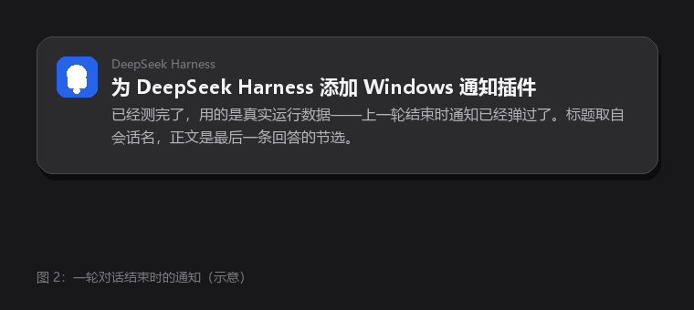
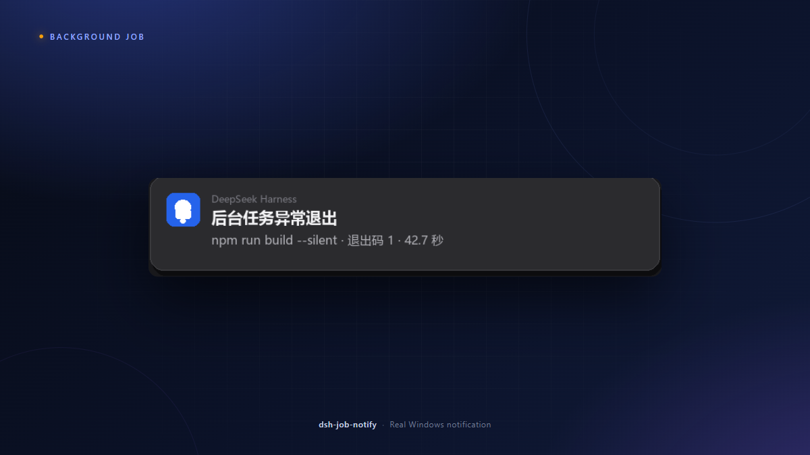
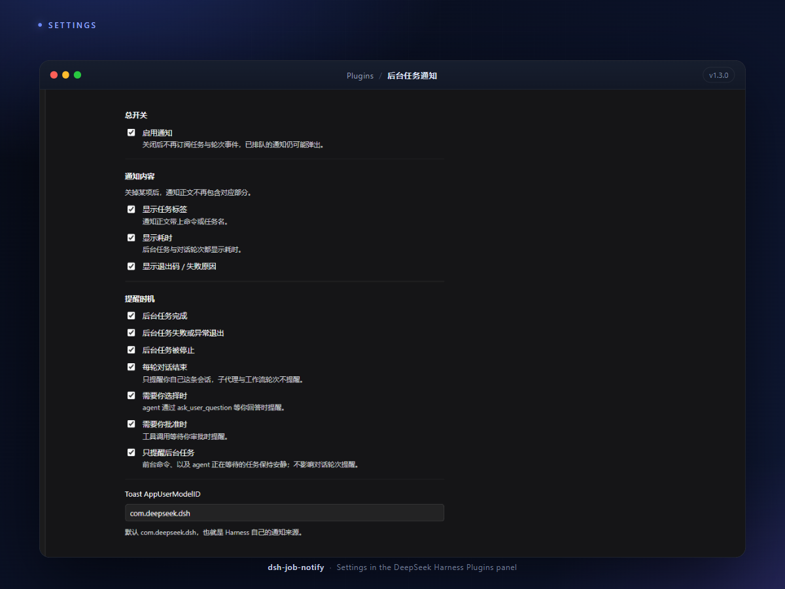
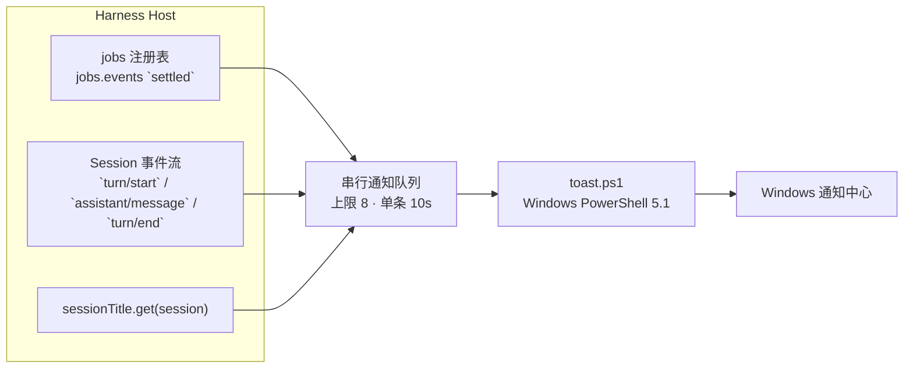

# dsh-job-notify

[简体中文](README.md) | [English](README.en.md)

**给 DeepSeek Harness 补上「任务结束提醒」：后台任务跑完、或者一轮对话结束，Windows 右下角弹一条原生通知。**

[](#限制与路线图)
[](https://github.com/deepseek-ai/deepseek-harness)
[](LICENSE)

DSH 把 shell 命令、子代理、workflow 都建模成后台任务，但不会在任务结束时打扰你。这个插件订阅任务注册表和会话事件，用 Windows PowerShell 5.1 的 WinRT `ToastNotificationManager` 发送通知，并复用 Harness 桌面版的 AppUserModelID，所以通知来源显示为 **DeepSeek Harness**，而不是「Windows PowerShell」。

> 适用于 DeepSeek Harness Desktop `0.2.2-rc.1`，声明兼容 `>=0.2.0-rc.1 <0.3.0-0`。仅 Windows。

---

## 目录

- [它解决什么问题](#它解决什么问题)
- [通知长什么样](#通知长什么样)
- [功能一览](#功能一览)
- [安装](#安装)
- [配置](#配置)
- [工作原理](#工作原理)
- [隐私与安全](#隐私与安全)
- [故障排查](#故障排查)
- [限制与路线图](#限制与路线图)
- [开发](#开发)
- [发布到 GitHub](#发布到-github)
- [License](#license)

---

## 它解决什么问题

让 agent 跑一个长任务，最烦的不是等，而是**不知道什么时候该回来看**：构建是不是已经结束？子代理写完没有？刚才那轮对话是不是已经答完？

`dsh-job-notify` 补上这一个缺口，只做两件事：

| 通知类型 | 触发时机 | 默认 |
|---|---|---|
| **后台任务** | 后台任务结算时（shell 的 `run_in_background` 是最常见来源） | 开 |
| **整轮对话** | 你自己这条会话的某一轮结束时 | 开 |
| **需要你决策** | agent 调用 `ask_user_question`，或工具调用等待你审批时 | 开 |

两类通知可以独立开关。前台命令、agent 正在等待的任务，以及你取消/打断的对话轮次都不会打扰你。

---

## 通知长什么样

### 一轮对话结束



<sub>示意图：标题是会话名，正文是本轮最后一条回答的纯文本节选（约 200 字），Markdown 语法会被剥掉。</sub>

- **标题**：会话标题，取自 Host 的 `sessionTitle` 服务；新会话还没生成标题时退回工作区目录名
- **正文**：本轮最后一条 assistant 回答的节选；如果这一轮只调用了工具、没有文本回答，回退为「本轮已完成」
- **耗时**：本轮从 `turn/start` 到 `turn/end` 的实际耗时
- **不通知**：取消、打断的轮次；子代理会话（`origin: "subagent"`）的轮次，包括以子代理方式运行的 workflow 子任务

### 后台任务结算



<sub>示意图：标题按结果区分，正文是任务标签、退出码和耗时。</sub>

标题有四种：

| 标题 | 含义 |
|---|---|
| `后台任务已完成` | 退出码为 0 |
| `后台任务异常退出` | 退出码非 0 |
| `后台任务失败` | 进程没能正常启动，或 producer 抛错 |
| `后台任务已停止` | 被 `job_kill` 或会话归档停止 |

正文由三段拼成，可以逐项关闭：任务标签（截断到 140 字）、退出码或失败原因、耗时。

> [!IMPORTANT]
> DSH 的 shell 工具把非零退出码报告成 `status: completed` + `detail: "exit code: N"`，而不是 `failed`。所以插件按**退出码**判断成败，否则失败的任务会被显示成「已完成」。

### 需要你决策

agent 停下来等你时，通知会明确区分两种场景：

- **需要你选择**：`ask_user_question` 等待你回答。正文是会话名 + 第一个问题；一次问多个问题时标注总数。
- **需要你批准**：工具调用等待审批。正文是会话名 + 工具名 + 审批原因。

问题和审批都只通知一次；你回答或批准后不会重复提醒。两类通知可以分别关闭。

---

## 功能一览

- **只提醒真正的后台任务**：默认判据是 `awaited === false`。前台 shell 调用也是 job，但调用方在等它，不算「无人收集的后台工作」。
- **按结果分类**：完成、异常退出、启动失败、被停止，四种标题一眼区分。
- **可读的正文**：任务标签 + 退出码/失败原因 + 耗时，全部可单独关闭。
- **对话轮次提醒**：会话标题 + 回答节选，回答里的 Markdown 会被清理成适合通知展示的纯文本。
- **决策提醒**：agent 卡在问题或审批上时，单独发一条「需要你选择 / 需要你批准」。
- **图形化配置**：插件详情页直接勾选，写入 profile 的 `cordis.patch.yml`，不必手改 YAML。
- **复用 Harness 的 AUMID**：通知来源显示为 DeepSeek Harness，并复用系统里已注册的通知图标。
- **有界发送**：串行队列、单条 10 秒超时、最多积压 8 条，避免任务风暴把 PowerShell 进程打爆。
- **零网络**：不请求任何远程地址，所有内容只在本机生成。

---

## 安装

### 前置条件

| 项目 | 要求 |
|---|---|
| 操作系统 | Windows 10 / 11 |
| Harness | DeepSeek Harness Desktop `>= 0.2.0-rc.1`，`< 0.3.0` |
| 运行时 | 随 Harness 提供的 Node.js（无需单独安装） |
| 通知 | 系统「设置 → 系统 → 通知」中允许 DeepSeek Harness 通知 |

### 通过插件管理器安装（推荐）

> 包名里的 `@local` 只是一个本地 scope。本项目不发布到 npm，通过本地目录安装即可，不需要 registry。

1. 把仓库克隆到本地任意目录，例如 `E:\dshWorkspace\dsh-job-notify`：

   ```powershell
   git clone https://github.com/imnotRiv3r/dsh-job-notify.git E:\dshWorkspace\dsh-job-notify
   ```

2. 进入插件目录安装依赖（只有 `@deepseek-ai/schemastery`）：

   ```powershell
   cd E:\dshWorkspace\dsh-job-notify
   npm install --omit=dev --no-package-lock
   ```

   > `link:` 类型的本地插件不会被 pnpm 自动安装依赖，所以插件目录必须自带 `node_modules`。用 pnpm 的话执行 `pnpm install --prod` 也可以。

3. 打开 Harness → **插件** → **添加插件** → 选择本地目录 `E:\dshWorkspace\dsh-job-notify`。

4. 插件管理器会把它写进 profile 的 `dsh.profile.bundles`。Host 侧立刻激活；配置页随下一次页面加载生效。

5. 验证：让 agent 跑一个后台命令，例如让它在后台执行 `Start-Sleep -Seconds 5`，5 秒后应看到通知。

### 手动安装（高级）

在 profile 的 `package.json` 中加入依赖：

```json
{
  "dependencies": {
    "@local/dsh-job-notify": "link:E:/dshWorkspace/dsh-job-notify"
  },
  "dsh": {
    "profile": {
      "bundles": ["@deepseek-ai/dsh-base", "@deepseek-ai/dsh-web-app", "@local/dsh-job-notify"]
    }
  }
}
```

然后重启 Harness。bundle 的 `cordis.patch.yml` 会向 Loader 插入 `job-notify` 这一行。

> [!NOTE]
> 插件是 `link:` 到本目录的。**别删或移动目录**，否则链接断掉、插件失效。更新代码后 Host 侧通常由 HMR 重载，浏览器侧需要刷新页面。

---

## 配置

### 图形化

**插件** → 点「后台任务通知」卡片进入详情页 → 配置区在描述下方直接展开。勾选或改文本即时生效，写入落在 profile 的 `cordis.patch.yml`。



### 手写

也可以直接在 profile 的 `cordis.patch.yml` 里按 entry id 覆盖：

```yaml
- id: job-notify
  name: "@local/dsh-job-notify"
  config:
    notifyTurnEnd: false
    showLabel: false
```

### 字段

| 字段 | 默认 | 含义 |
|---|---|---|
| `enabled` | `true` | 总开关；关闭后不订阅任何事件 |
| `notifyTurnEnd` | `true` | 每轮对话结束时提醒 |
| `notifyQuestions` | `true` | agent 通过 `ask_user_question` 等你回答时提醒 |
| `notifyApprovals` | `true` | 工具调用等待你审批时提醒 |
| `onCompleted` | `true` | 后台任务完成时提醒 |
| `onFailed` | `true` | 后台任务失败 / 异常退出时提醒 |
| `onKilled` | `true` | 后台任务被停止时提醒 |
| `skipAwaited` | `true` | 只提醒无人等待的后台任务；设为 `false` 连前台命令也提醒 |
| `showLabel` | `true` | 正文显示任务标签（命令内容） |
| `showDuration` | `true` | 正文显示耗时（任务与对话轮次都生效） |
| `showExitCode` | `true` | 正文显示退出码或失败原因 |
| `appId` | `com.deepseek.dsh` | Toast 使用的 AppUserModelID |

`appId` 只接受字母、数字、点、下划线、连字符，长度不超过 128；非法值会回退到 `com.deepseek.dsh`。

---

## 工作原理



### 事件来源

**后台任务**

```js
ctx.jobs.events.subscribe({ owners: 'all' }, event => {
  if (event.type !== 'settled') return
  if (event.cause === 'teardown') return
  // ...按 outcome 与配置过滤
})
```

`settled` 事件带 `job`（任务快照）、`cause`（`producer` / `kill` / `teardown`）和 `awaited`（是否释放了仍在等待的调用方）。teardown 结算属于正在卸载的会话，不是用户完成的工作，直接跳过。

**整轮对话**

```js
ctx.on('session/event', (session, event) => {
  // turn/start          → 记录开始时间
  // assistant/message   → 缓存最后一条回答文本
  // turn/end            → 按 reason 决定是否通知
})
```

`turn/end` 的 `reason.kind` 可能是 `completed`、`error`、`max-tokens`、`aborted`、`blocked`、`hook`、`idle`、`maintenance`。只通知前三种：取消、阻塞、维护、hook 等都不是「有结果可看」的结束。

用 `session/event` 而不是 `agent/status`（running → idle）的原因：`turn/end` 带结束原因，能区分「正常完成」和「用户取消」，也能拿到这一轮到底说了什么。

**需要你决策**

```js
// 问题：只读观察，始终 next() 委托，不回答也不拦截
ctx.on('user-questions/request', (request, next) => {
  notify(request.questions)
  return next()
})

// 审批：读取会话事件，不改变审批结果
ctx.on('session/event', (session, event) => {
  if (event.type === 'approval/asked') notify(event.data)
})
```

问题走 `user-questions/request` waterfall；插件只是旁听者，必须把决定交还给真正的回答方。审批走 `approval/asked` 审计事件，同样只读。

### 通知发送

每条通知启动一次 Windows PowerShell 5.1，用 WinRT 的 `ToastNotificationManager` 发 toast：

```powershell
[Windows.UI.Notifications.ToastNotificationManager, Windows.UI.Notifications, ContentType = WindowsRuntime]
$template = [Windows.UI.Notifications.ToastNotificationManager]::GetTemplateContent(
  [Windows.UI.Notifications.ToastTemplateType]::ToastText02)
$texts.Item(0).AppendChild($template.CreateTextNode($title))
$texts.Item(1).AppendChild($template.CreateTextNode($body))
[Windows.UI.Notifications.ToastNotificationManager]::CreateToastNotifier($appId).Show($toast)
```

几个关键点：

- **必须用 Windows PowerShell 5.1**。PowerShell 7（`pwsh`）没有 WinRT 投影，加载不了 `Windows.UI.Notifications` 类型。
- **参数走 base64 JSON**。`index.js` 把标题/正文编码成一条 base64 字符串传给脚本，命令行保持纯 ASCII，中文和引号不会被控制台代码页破坏。
- **串行队列 + 超时**。一波同时结算的任务不会引发 PowerShell 进程风暴；卡住的进程会被杀掉，不会堵死后续通知。
- **复用 Harness 的 AUMID**。通知来源用 `com.deepseek.dsh`（Harness 桌面版已注册），所以显示成 **DeepSeek Harness**。
- **XML 安全**。标题和正文用 `CreateTextNode` 写入，不会把命令里的 `<`、`&` 当成标记解析。

### 配置为什么必须 `.volatile()`

Host 的 settings 服务用 `volatileForm()` 生成可编辑表单，而它**只保留 volatile 节点**：

```ts
export function volatileForm(schema) {
  if (schema.meta.volatile) return plainSchema(schema)
  if (schema.type === 'object') {
    const dict = Object.fromEntries(Object.entries(schema.dict ?? {}).flatMap(([key, child]) => {
      const field = volatileForm(child)
      return field === undefined ? [] : [[key, field]]
    }))
    return Object.keys(dict).length === 0 ? undefined : z.object(dict)
  }
  return undefined
}
```

普通字段会被整条过滤掉，结果是 `describe()` 跳过这个 entry、配置区**静默不出现**（不报错）。所以 `Config` 的每个字段都必须：

```js
enabled: z.boolean().default(true).volatile().description('总开关：关闭后不发送任何通知。')
```

对应地，`apply` 里读这些字段要走 `.get()`，因为 volatile 字段解析成的是引用。

### 配置页注册在哪

浏览器半注册在 `plugins.bundle.config`（bundle 详情页直接显示），而不是 `plugins.row.config`：后者的 `form` 要求 settings 命名空间与 row id 严格相等，而且入口藏在二级页面里。

---

## 隐私与安全

- **不联网**。插件不发起任何 HTTP 请求，也不读取凭据。
- **通知内容来自本机会话**：会话标题、最后一条回答的节选、任务命令与退出码。它们会进入 Windows 通知中心的历史记录，敏感项目请自行评估。
- **执行本机脚本**：插件用 `-ExecutionPolicy Bypass -File toast.ps1` 启动 Windows PowerShell。脚本本身只做 toast，不含网络和文件操作，可自行审查 [`toast.ps1`](toast.ps1)。
- **无额外权限**：不申请管理员权限，不修改系统通知设置。
- **配置写入**：图形化配置只写当前 profile 的 `cordis.patch.yml`。

---

## 故障排查

| 现象 | 原因与处理 |
|---|---|
| **完全不弹通知** | 先看系统设置：设置 → 系统 → 通知 → DeepSeek Harness 是否开启；专注助手 / 勿扰模式会压掉通知 |
| **全屏看视频/游戏时不弹横幅** | Windows 会抑制全屏应用上的通知横幅，通知通常仍进入通知中心（`Win + N` 可见）。设置 → 系统 → 专注助手 → 自动规则 → “当我正在全屏模式下使用应用时” → 关闭；部分独占全屏播放器仍可能遮挡 |
| **通知来源显示「Windows PowerShell」** | `appId` 被改成了未注册的值；改回 `com.deepseek.dsh`，或注册自己的 AUMID |
| **配置区空白** | 检查 `Config` 字段是否都挂了 `.volatile()`（见上文） |
| **标题显示成 `dshWorkspace`** | `sessionTitle` 还没生成标题，退回目录名；新会话发第一条消息后就会正常 |
| **对话通知正文是「本轮已完成」** | 该轮最后一条 assistant 消息没有文本块（例如只调用了工具），属正常回退 |
| **只有后台任务通知，没有对话通知** | 检查 `notifyTurnEnd`；子代理 / workflow 会话本来就不通知 |
| **agent 提问或审批时没收到通知** | 检查 `notifyQuestions` / `notifyApprovals`；子代理不能发起人机交互，这类请求本身会被 DSH 拒绝 |
| **前台命令也弹通知** | `skipAwaited` 被设成了 `false` |
| **通知延迟很久** | 队列串行发送，每条最多 10 秒；大量任务同时结算时会排队，最多积压 8 条 |
| **改了代码没生效** | Host 半靠 HMR 重载 bundle；浏览器半需要刷新页面；必要时重启 Harness |
| **日志里出现 `toast failed`** | 多半是 PowerShell 被安全软件拦截，或系统通知被策略禁用；查看 Harness 日志中的完整原因 |

---

## 限制与路线图

**已知限制**

- 仅 Windows。其他平台插件会保持空闲，不会报错。
- 通知文案固定中文，不随 Harness 界面语言切换。
- 点击通知不会聚焦 Harness 窗口（需要注册 COM activator）。
- 通知是纯文本，Markdown 只做剥离，不做渲染。
- 配置页依赖 Harness 的 `plugins.bundle.config` 与 `configForms` 内部服务，Harness 大版本升级时可能需要适配。
- 通知内容会进入系统通知历史，无法由插件控制保留时长。
- 插件是 `link:` 到本目录的，**别删目录**，否则链接断掉、插件失效。

**可能的方向**

- 点击通知聚焦到对应会话（需要协议激活 / COM activator）。
- 通知音效与静默时段。
- 按 Harness 界面语言切换通知文案。
- macOS / Linux 后端（`osascript` / `notify-send`）。

欢迎开 issue 讨论，或直接提 PR。

---

## 开发

### 目录结构

| 路径 | 作用 |
|---|---|
| `index.js` | Host 半入口：Config schema、事件订阅、轮次报告、装配 |
| `lib/format.js` | 纯函数：配置归一化、文本截断、耗时、退出码判定、通知拼装、Markdown 清理 |
| `lib/toast.js` | PowerShell 定位与调用、base64 编码、串行通知队列 |
| `client.js` | 浏览器半：在插件详情页渲染配置表单 |
| `toast.ps1` | Windows toast 发送器（WinRT） |
| `cordis.patch.yml` | bundle 的 Loader 补丁，插入 `job-notify` 行 |
| `locale/` | 插件管理器里显示的标题和描述 |
| `test/` | `node:test` 单元测试 |
| `docs/` | README 截图 |

### 本地检查

```powershell
npm run check   # node --check 语法检查
npm test        # node:test 单元测试
```

测试不依赖 Harness，也不真的发通知：`lib/toast.js` 的进程调用可以注入，队列行为用假 runner 验证。

### 手动验证通知

不启动 Harness，也可以直接调用 PowerShell 脚本：

```powershell
$payload = @{ title = '测试通知'; body = '来自 dsh-job-notify'; appId = 'com.deepseek.dsh' } | ConvertTo-Json -Compress
$encoded = [Convert]::ToBase64String([Text.Encoding]::UTF8.GetBytes($payload))
powershell.exe -NoProfile -NonInteractive -ExecutionPolicy Bypass -File .\toast.ps1 -PayloadBase64 $encoded
```

### 设计取舍

- **按退出码判断成败**：DSH 的 shell producer 把非零退出报告为 `completed`，不能只看 `status`。
- **用会话事件而不是 agent 状态**：需要 `turn/end` 的 reason 与回答正文。
- **一条通知一个 PowerShell 进程**：WinRT 类型只能在 Windows PowerShell 5.1 里加载；进程隔离也避免一个失败拖垮整个插件。用队列和超时控制成本。
- **配置全部 volatile**：否则配置区静默消失，这是 DSH settings 的既有行为。

---

## 发布到 GitHub

本项目已经发布在 **[github.com/imnotRiv3r/dsh-job-notify](https://github.com/imnotRiv3r/dsh-job-notify)**。

如果你 fork 后要重新发布，完整步骤见 **[docs/PUBLISHING.md](docs/PUBLISHING.md)**，包含建仓、认证、推送、替换仓库地址、打 tag 和发 Release。

---

## License

[MIT](LICENSE)

---

<sub>本项目与 DeepSeek 官方无隶属关系。DeepSeek Harness 是其权利人的商标。</sub>
