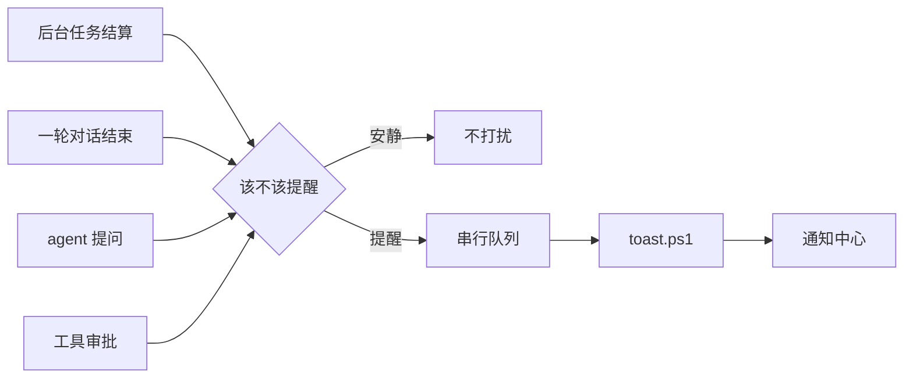

# dsh-job-notify

[简体中文](README.md) | [English](README.en.md)

**构建在后台跑完，你去倒了杯水；  
agent 停在选项上等你拍板，你在看剧。**

这条 Windows 原生通知只做一件事：在该回来的时候，把你叫回来。

---

## 四个会被叫回来的时刻

| 时刻 | 通知里有什么 | 默认 |
|---|---|---|
| 后台任务完成 | 命令、耗时 | 开 |
| 后台任务失败 / 异常退出 | 命令、退出码、耗时 | 开 |
| agent 等你选择 | 会话名、问题、问题数量 | 开 |
| 工具等你批准 | 会话名、工具名、原因 | 开 |

外加一类“这一轮聊完了”的通知：会话名 + 最后一条回答的节选。

---

## 什么时候它保持安静

| 场景 | 为什么安静 |
|---|---|
| 前台 shell 命令 | 调用方在等它，不是无人收集的后台工作 |
| agent 正在 `job_output(wait: true)` | 等待方已经收走了结算 |
| 你取消 / 打断的轮次 | 结束原因是 `aborted`，没有新内容可看 |
| 子代理、workflow 子任务 | 它们的轮次不是你这条会话 |
| 会话卸载时的 teardown | 不是用户完成的工作 |

判据是 `awaited === false`：**只有没人等的结算才值得叫你**。前台命令再慢也不会响。

---

## 通知长什么样

### 后台任务结算

标题按结果区分，正文是命令、退出码和耗时。

标题有四种：

| 标题 | 含义 |
|---|---|
| `后台任务已完成` | 退出码 0 |
| `后台任务异常退出` | 退出码非 0 |
| `后台任务失败` | 进程没能启动，或 producer 抛错 |
| `后台任务已停止` | 被 `job_kill` 或会话归档停止 |

正文由三段组成，可逐项关闭：任务标签（截断到 140 字）、退出码/失败原因、耗时。

> [!IMPORTANT]
> DSH 的 shell 工具把非零退出码报告成 `status: completed` + `detail: "exit code: N"`，不是 `failed`。所以插件按**退出码**判断成败，否则失败的构建会被说成「已完成」。

### 一轮对话结束

- **标题**：会话标题；新会话还没生成标题时退回工作区目录名
- **正文**：本轮最后一条 assistant 回答的节选，Markdown 语法会被剥掉
- **耗时**：从 `turn/start` 到 `turn/end` 的实际用时
- **不提醒**：取消/打断的轮次；子代理会话（`origin: "subagent"`）

### 需要你决策

- **需要你选择**：`ask_user_question` 停在那里等你。正文是会话名 + 第一个问题；一次问多个会标注总数。
- **需要你批准**：工具调用等待审批。正文是会话名 + 工具名 + 原因。

插件只是旁听：问题走 `user-questions/request` waterfall，始终 `next()` 委托；审批读 `approval/asked` 审计事件。它**不会替你回答，也不会改变审批结果**。

---

## 安装

### 前置条件

| 项目 | 要求 |
|---|---|
| 系统 | Windows 10 / 11 |
| 客户端 | Desktop 或 Web（`dsh web`）；Host 必须运行在 Windows |
| Harness | DeepSeek Harness Desktop 或 `dsh web` ≥ `0.2.0-rc.1`，< `0.3.0` |
| 通知 | 系统设置里允许 DeepSeek Harness 通知 |
| 运行时 | 随 Harness 提供的 Node.js，无需单装 |

### 30 秒装好

```powershell
git clone https://github.com/imnotRiv3r/dsh-job-notify.git E:\dshWorkspace\dsh-job-notify
cd E:\dshWorkspace\dsh-job-notify
npm install --no-package-lock
```

然后打开 Harness：

**插件 → 添加插件 → 选择本地目录** `E:\dshWorkspace\dsh-job-notify`

插件管理器会把它写进 profile 的 `dsh.profile.bundles`。Host 侧立刻生效，配置页随下一次页面刷新出现。

Desktop 和 `dsh web` 的**插件**页操作相同：Web 版只是把界面放在浏览器里，通知仍由 Host 进程发出。

验证：让 agent 在后台执行一条命令，比如 `Start-Sleep -Seconds 5`，5 秒后应该弹出通知。

> 包名 `dsh-job-notify` 同时用于 npm 发布与本地 `link:` 安装；Loader 行的 `name` 必须与包名一致，否则 Host 侧 `ERR_MODULE_NOT_FOUND`。本地 `link:` 安装由 devDependencies 提供 `@deepseek-ai/schemastery`；从插件市场安装时它由 Harness 以 peerDependency 提供，不需要单独安装。

<details>
<summary>手动安装到 profile</summary>

在 profile 的 `package.json` 中加依赖，并把 bundle 加进列表：

```json
{
  "dependencies": {
    "dsh-job-notify": "link:E:/dshWorkspace/dsh-job-notify"
  },
  "dsh": {
    "profile": {
      "bundles": ["@deepseek-ai/dsh-base", "@deepseek-ai/dsh-web-app", "dsh-job-notify"]
    }
  }
}
```

重启 Harness。bundle 的 `cordis.patch.yml` 会向 Loader 插入 `job-notify` 行。

</details>

> [!NOTE]
> 插件是 `link:` 到本目录的，**别删或移动目录**。更新代码后 Host 侧通常由 HMR 重载，浏览器侧刷新页面即可。

---

## 配置

**插件 → 后台任务通知**，配置区在详情页直接展开。勾选即时生效，写入 profile 的 `cordis.patch.yml`。

### 字段

**总开关**

| 字段 | 默认 | 作用 |
|---|---|---|
| `enabled` | `true` | 关闭后不订阅任何事件 |

**什么时候提醒**

| 字段 | 默认 | 作用 |
|---|---|---|
| `notifyTurnEnd` | `true` | 每轮对话结束 |
| `notifyQuestions` | `true` | agent 通过 `ask_user_question` 等你选择 |
| `notifyApprovals` | `true` | 工具调用等你审批 |
| `onCompleted` | `true` | 后台任务完成 |
| `onFailed` | `true` | 后台任务失败 / 异常退出 |
| `onKilled` | `true` | 后台任务被停止 |
| `skipAwaited` | `true` | 只提醒无人等待的后台任务；设为 `false` 连前台命令也提醒 |

**正文显示什么**

| 字段 | 默认 | 作用 |
|---|---|---|
| `showLabel` | `true` | 任务标签（命令内容） |
| `showDuration` | `true` | 耗时（任务与对话轮次都生效） |
| `showExitCode` | `true` | 退出码或失败原因 |

**高级**

| 字段 | 默认 | 作用 |
|---|---|---|
| `appId` | `com.deepseek.dsh` | Toast 使用的 AppUserModelID |

`appId` 只接受字母、数字、点、下划线、连字符，长度不超过 128；非法值回退到默认。

### 手写覆盖

```yaml
- id: job-notify
  name: "dsh-job-notify"
  config:
    notifyTurnEnd: false
    showLabel: false
```

---

## 它怎么工作



- **后台任务**：订阅 `jobs.events` 的 `settled`，跳过 `cause: 'teardown'`，用 `awaited` 判断是否有人等待。
- **对话轮次**：`turn/end` 的 `reason.kind` 只认 `completed` / `error` / `max-tokens`；取消、阻塞、维护都不提醒。
- **问题与审批**：只读观察，不介入回答或审批。
- **发送**：一条通知一个 PowerShell 5.1 进程。参数走 base64 JSON，命令行保持纯 ASCII，中文和引号不会被代码页破坏。串行队列防止任务风暴，单条 10 秒超时。
- **AUMID**：复用 Harness 桌面版已注册的 `com.deepseek.dsh`，通知来源显示为 **DeepSeek Harness**。

<details>
<summary>为什么配置字段都必须 <code>.volatile()</code></summary>

Host 的 settings 服务用 `volatileForm()` 生成可编辑表单，只保留 volatile 节点。普通字段会被整条过滤掉，结果是配置区**静默不出现**（不报错）。所以 `Config` 里每个字段都挂了 `.volatile()`，`apply` 读取时走 `.get()`。

</details>

---

## 隐私

- **不联网**：不请求任何远程地址，不读凭据。
- **内容来自本机会话**：会话标题、回答节选、命令、退出码。它们会进入 Windows 通知历史，敏感项目请自行评估。
- **本机脚本**：用 `-ExecutionPolicy Bypass -File toast.ps1` 启动 Windows PowerShell；脚本只做通知，可自行审查。
- **配置写入**：只写当前 profile 的 `cordis.patch.yml`。

---

## 常见问题

<details>
<summary>全屏看视频时没有横幅？</summary>

Windows 会抑制全屏应用上的通知横幅，通知仍会进通知中心（`Win + N`）。部分播放器使用独占全屏，任何应用都盖不上去；改用窗口化 / 无边框全屏即可看到横幅。

</details>

<details>
<summary>配置区空白？</summary>

检查 `Config` 字段是否都挂了 `.volatile()`。普通字段会让整个配置区静默消失。

</details>

<details>
<summary>通知标题显示成工作区目录名？</summary>

`sessionTitle` 还没生成标题，退回了目录名。新会话发第一条消息后就会正常。

</details>

<details>
<summary>前台命令也弹通知？</summary>

`skipAwaited` 被设成了 `false`。改回 `true` 只提醒无人等待的后台任务。

</details>

<details>
<summary>agent 提问或审批时没收到通知？</summary>

检查 `notifyQuestions` / `notifyApprovals`。子代理不能发起人机交互，这类请求本身会被 DSH 拒绝。

</details>

<details>
<summary>改了代码没生效？</summary>

Host 半靠 HMR 重载 bundle；浏览器半需要刷新页面；必要时重启 Harness。日志里出现 `toast failed` 时，检查 PowerShell 是否被安全软件拦截。

</details>

---

## 限制

- 仅 Windows；其他平台插件保持空闲。
- 通知文案固定中文。
- 点击通知不会聚焦 Harness 窗口（需要 COM activator）。
- 通知是纯文本，Markdown 只剥离不渲染。
- 独占全屏无法覆盖；系统静音无法绕过。
- 配置页依赖 Harness 的 `plugins.bundle.config` 与 `configForms` 内部服务，大版本升级时可能需要适配。
- 插件是 `link:` 的，删目录会失效。
- `dsh web` 的通知由 Host 进程发出：Host 跑在 Windows 且你在本机时可用；从其他设备远程访问 Web 时，通知仍在 Host 上，不会出现在浏览器或手机。
- 纯 `dsh web` 部署（未安装 Desktop）可能没有注册 `com.deepseek.dsh` AUMID；通知不显示时，在配置里改用已注册的 AUMID。

---

## 开发

| 路径 | 作用 |
|---|---|
| `index.js` | Host 入口：Config、事件订阅、轮次与决策提醒 |
| `lib/format.js` | 纯函数：配置归一化、截断、耗时、成败判定、通知拼装、Markdown 清理 |
| `lib/toast.js` | PowerShell 调用、base64 编码、串行通知队列 |
| `client.js` | 浏览器半：配置页 |
| `toast.ps1` | WinRT toast 发送器 |
| `test/` | `node:test` 单元测试 |
| `cordis.patch.yml` | bundle 的 Loader 补丁 |

```powershell
npm run check   # node --check
npm test        # node:test，22 个用例
```

测试不依赖 Harness，也不会真的发通知：`lib/toast.js` 的进程调用可注入，队列用假 runner 验证。

手动发一条通知：

```powershell
$payload = @{ title = '测试通知'; body = '来自 dsh-job-notify'; appId = 'com.deepseek.dsh' } | ConvertTo-Json -Compress
$encoded = [Convert]::ToBase64String([Text.Encoding]::UTF8.GetBytes($payload))
powershell.exe -NoProfile -ExecutionPolicy Bypass -File .\toast.ps1 -PayloadBase64 $encoded
```

---

## License

[MIT](LICENSE)

<sub>本项目与 DeepSeek 官方无隶属关系。DeepSeek Harness 是其权利人的商标。</sub>
