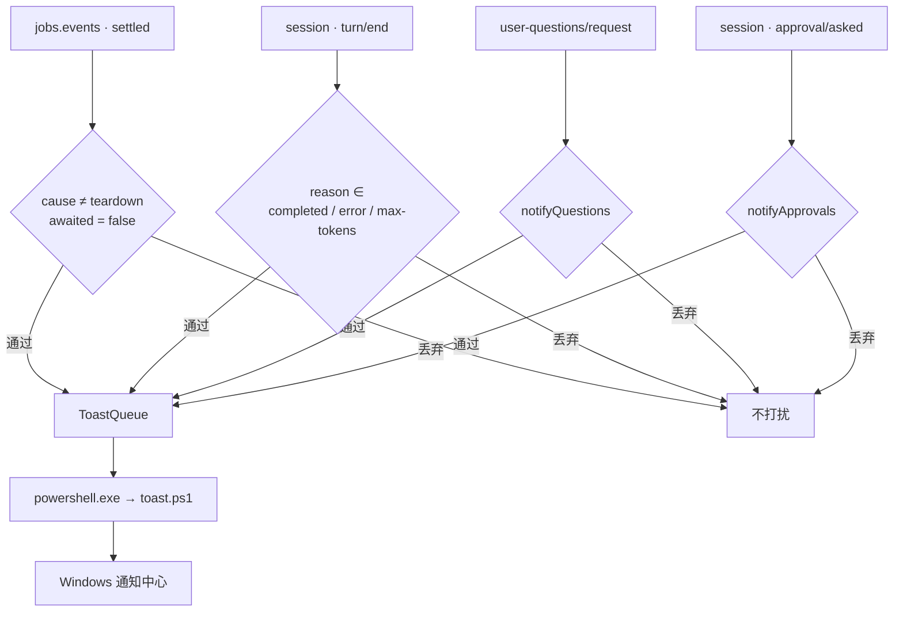

# dsh-job-notify

[English](README.md) · [简体中文](README.zh-CN.md)

[](https://www.npmjs.com/package/dsh-job-notify)
[](LICENSE)
[](#兼容性)
[](#兼容性)
[](#兼容性)
[](test/)

**给没人盯着的那些活儿发通知。**

构建在后台跑完，你去倒了杯水；agent 停在选项上等你拍板，你在看剧。
这个插件只在这些时刻把你叫回来——而你正在等的命令，它一声不响。

---

## 目录

- [你会得到什么](#你会得到什么)
- [什么时候它保持安静](#什么时候它保持安静)
- [通知长什么样](#通知长什么样)
- [安装](#安装)
- [配置](#配置)
- [它怎么工作](#它怎么工作)
- [隐私](#隐私)
- [兼容性](#兼容性)
- [故障排查](#故障排查)
- [限制](#限制)
- [开发](#开发)
- [参与共建](#参与共建)
- [License](#license)

---

## 你会得到什么

六种通知，各自有独立开关：

| 通知 | 触发条件 | 默认 | 用哪个开关关掉 |
|---|---|---|---|
| 后台任务完成 | 无人等待的任务退出码为 0 | 开 | `onCompleted` |
| 后台任务失败 | 退出码非 0，或进程根本没启动 | 开 | `onFailed` |
| 后台任务已停止 | 被 `job_kill` 或会话归档终止 | 开 | `onKilled` |
| 一轮对话结束 | 你自己这条会话以 completed / error / max-tokens 结束 | 开 | `notifyTurnEnd` |
| 需要你选择 | agent 阻塞在 `ask_user_question` 上 | 开 | `notifyQuestions` |
| 需要你批准 | 工具调用等待你的审批 | 开 | `notifyApprovals` |

比清单本身更重要的有两点：

- **只在没人收的工作上出声。** 再慢的前台命令也不会叫你，因为调用方正在等它。只有
  `awaited === false` 的结算才算后台工作。
- **只旁听，不决定。** 问题与审批通知是只读的：插件始终 `next()` 委托，不会替你回答，
  也不会改变审批结果。

---

## 什么时候它保持安静

| 场景 | 为什么安静 |
|---|---|
| 前台 shell 命令 | 调用方在等它，不是无人收集的工作 |
| agent 用 `job_output(wait: true)` 在等的任务 | `awaited` 为 `true` |
| 取消 / 打断的轮次 | 结束原因不在 `completed` / `error` / `max-tokens` 里 |
| 子代理、workflow 会话 | 它们的轮次不是你这条会话（`origin: "subagent"`） |
| 会话卸载时的结算 | `cause: "teardown"` 属于正在卸载的会话 |
| 插件被关闭 | `enabled: false` 会取消全部订阅 |
| Host 不在 Windows | 只打一行日志，然后保持空闲 |

前两行背后是同一条判据：**只有没人等的工作才值得叫你。** 想让每次结算都提醒（包括前台
命令），把 `skipAwaited` 设为 `false`。

---

## 通知长什么样

Windows 只渲染两行文字：标题和正文。下面是每种通知的真实形态——边框代表 Windows 横幅。

**后台任务完成**——标题说结果，正文带标签和耗时：

```
┌ Windows · DeepSeek Harness
│  后台任务已完成
│  npm run build · 1 分 12 秒
└ ─────────────────────────────────────────
```

**后台任务异常退出**——退出码进入正文：

```
┌ Windows · DeepSeek Harness
│  后台任务异常退出
│  npm test · 退出码 1 · 4.3 秒
└ ─────────────────────────────────────────
```

**后台任务失败或被停止**——失败原因占据退出码那一格：

```
┌ Windows · DeepSeek Harness
│  后台任务失败
│  npm install · spawn npm ENOENT · 0.2 秒
└ ─────────────────────────────────────────
```

**一轮对话结束**——标题是会话标题，正文是这一轮最后一条回答的节选。只跑了工具、没有回答文字
的轮次会回退成 `本轮已完成` / `本轮达到输出上限`，出错的轮次则是 `本轮出错：…`：

```
┌ Windows · DeepSeek Harness
│  dsh-job-notify
│  README 已重写，P1 可以提 PR 了 · 2 分 41 秒
└ ─────────────────────────────────────────
```

**需要你选择**——先给问题；一次问多个时带上总数：

```
┌ Windows · DeepSeek Harness
│  需要你选择
│  dsh-job-notify · 先做 P1 还是 P1–P3？（共 2 个问题）
└ ─────────────────────────────────────────
```

**需要你批准**——工具名和给你的理由：

```
┌ Windows · DeepSeek Harness
│  需要你批准
│  dsh-job-notify · 工具：pwsh · 执行 git push
└ ─────────────────────────────────────────
```

### 文案是怎么拼出来的

| 类型 | 标题 | 正文 |
|---|---|---|
| 后台任务 | 下面四种固定标题之一 | `{标签} · {退出码或失败原因} · {耗时}` |
| 对话轮次 | 会话标题 → 工作区目录名 → `DeepSeek Harness` | `{回答节选} · {耗时}` |
| 需要你选择 | `需要你选择` | `{会话名} · {第一个问题}`（+ `（共 N 个问题）`） |
| 需要你批准 | `需要你批准` | `{会话名} · 工具：{工具名} · {理由}` |

各段用 ` · ` 连接，空段直接丢弃——所以关掉 `showLabel` 只是少一段，不会留出空位。

### 一个任务算成功还是失败

标题先看退出码，再看状态：

| `job.status` | `detail` | 判定 | 标题 |
|---|---|---|---|
| `killed` | 任意 | killed | `后台任务已停止` |
| `failed` | 任意 | failed | `后台任务失败` |
| `completed` | `exit code: N`，N ≠ 0 | nonzero | `后台任务异常退出` |
| `completed` | `exit code: 0` 或无退出码 | completed | `后台任务已完成` |

> [!IMPORTANT]
> DSH 的 shell 工具把非零退出码报告成 `status: completed` + `detail: "exit code: N"`，
> **不是** `failed`。所以本插件按**退出码**判断成败；只看状态会把失败的构建说成「已完成」。
> `exit code: N` 与工具结果标记 `[exit code: N]` 两种写法都能识别，负数也保留。

### 截断与格式

| 部分 | 预算 | 行为 |
|---|---|---|
| 标题 | 80 字素 | 为空时回退到 `DeepSeek Harness` |
| 任务标签 | 140 字素 | 回退到任务类型，再回退到 `后台任务` |
| 细节 / 工具名 / 理由 | 各 90 字素 | 连续空白压成单个空格 |
| 回答节选 | 200 字素 | 先剥掉 Markdown 再截断 |
| `appId` | 128 字符 | 非法值回退到 `com.deepseek.dsh` |

截断按**字素**进行（emoji 不会被切成两半），超出时补 `…`。

耗时做了人话化：`4.3 秒`、`1 分 12 秒`、`1 小时 5 分`。59.95 秒以下保留一位小数；超过则先
四舍五入到整秒，所以 119.9 秒显示为 `2 分`，绝不会出现 `1 分 60 秒`。

---

## 安装

### 前置条件

| 项目 | 要求 |
|---|---|
| 系统 | Windows 10 / 11 |
| 客户端 | DeepSeek Harness Desktop，或 `dsh web` |
| Host | 必须运行在 Windows——通知由 Host 进程发出，不是浏览器 |
| Harness | ≥ `0.2.0-rc.1`，< `0.3.0` |
| Node.js | ≥ 20，无需单独安装（Harness 自带） |
| 通知权限 | Windows 设置 → 通知里允许 **DeepSeek Harness** |

### 第 1 步——拿到插件

**方式 A：插件市场。** 从插件目录里安装，包名 `dsh-job-notify`。它已发布到 npm，而
`@deepseek-ai/schemastery` 由 Harness 以 peerDependency 提供，不需要另装。

**方式 B：本地目录。** 适合跟 `main` 或改代码：

```powershell
git clone https://github.com/imnotRiv3r/dsh-job-notify.git E:\dshWorkspace\dsh-job-notify
cd E:\dshWorkspace\dsh-job-notify
npm install --no-package-lock
```

### 第 2 步——装进 Harness

**插件 → 添加插件 → 选择本地目录**（方式 B），或从市场安装（方式 A）。

插件管理器会把 bundle 写进 profile 的 `dsh.profile.bundles`。Host 侧立刻生效；配置区在下次
刷新页面后出现。

Desktop 和 `dsh web` 的插件页是同一个。两者的通知都由 Host 进程发出，所以另一台机器上的
浏览器收不到这台机器的通知。

<details>
<summary>手动装进 profile</summary>

在 profile 的 `package.json` 里加依赖与 bundle：

```json
{
  "dependencies": {
    "dsh-job-notify": "link:E:/dshWorkspace/dsh-job-notify"
  },
  "dsh": {
    "profile": {
      "bundles": ["@deepseek-ai/dsh-base", "@deepseek-ai/dsh-web-app", "dsh-job-notify"]
    }
  }
}
```

重启 Harness。bundle 的 `cordis.patch.yml` 会插入 `job-notify` 行。

</details>

### 第 3 步——验证

让 agent 在后台跑一条命令，例如：

```powershell
Start-Sleep -Seconds 5
```

任务结束后几秒内应该弹出通知。没有的话，按[故障排查](#故障排查)逐条查。

> [!NOTE]
> 本地安装是 `link:` 到目录的——装好后别删、别移动。改代码后 Host 侧通常由 HMR 重载，
> 浏览器侧刷新页面即可。

### 卸载

在插件面板里移除插件（会一并去掉 bundle 与配置项），本地目录按需删除。profile 里的残留位于
该 profile 的 `package.json` 与 `cordis.patch.yml`。

---

## 配置

**插件 → 后台任务通知**——配置区直接展开在插件详情页里。改动写入 profile 的
`cordis.patch.yml`，无需重启即可生效（配置区本身首次出现需要刷新一次页面）。

### 总开关

| 字段 | 默认 | 作用 |
|---|---|---|
| `enabled` | `true` | 关闭后取消全部订阅；已排队的通知仍可能弹出 |

### 提醒什么

| 字段 | 默认 | 作用 |
|---|---|---|
| `onCompleted` | `true` | 后台任务完成 |
| `onFailed` | `true` | 后台任务失败，或退出码非 0 |
| `onKilled` | `true` | 后台任务被停止 |
| `notifyTurnEnd` | `true` | 每轮对话结束各提醒一次 |
| `notifyQuestions` | `true` | agent 阻塞在 `ask_user_question` |
| `notifyApprovals` | `true` | 工具调用等待审批 |

### 安静规则

| 字段 | 默认 | 作用 |
|---|---|---|
| `skipAwaited` | `true` | 只提醒无人等待的任务。设为 `false` 连前台命令也提醒——包括 agent 正在等的一切 |

### 正文显示什么

| 字段 | 默认 | 作用 |
|---|---|---|
| `showLabel` | `true` | 显示命令 / 任务标签 |
| `showDuration` | `true` | 显示耗时（任务与轮次都生效） |
| `showExitCode` | `true` | 显示退出码；失败或停止的任务显示失败原因 |

### 高级

| 字段 | 默认 | 作用 |
|---|---|---|
| `appId` | `com.deepseek.dsh` | Toast 使用的 AppUserModelID。只接受字母、数字、`.`、`_`、`-`，最长 128 字符；非法值回退默认 |

默认 `appId` 复用了 Harness 已注册的那个，所以通知来源显示为 **DeepSeek Harness**，而不是
泛泛的 PowerShell。

### 预设

把其中一段抄进 profile 的 `cordis.patch.yml`：

```yaml
# 只报失败——最安静但够用的设置
- id: job-notify
  name: "dsh-job-notify"
  config:
    onCompleted: false
    notifyTurnEnd: false

# 只要任务，不要对话噪音
- id: job-notify
  name: "dsh-job-notify"
  config:
    notifyTurnEnd: false
    notifyQuestions: false
    notifyApprovals: false

# 一个都不漏，前台命令也提醒
- id: job-notify
  name: "dsh-job-notify"
  config:
    skipAwaited: false

# 正文最简：只要结果和耗时
- id: job-notify
  name: "dsh-job-notify"
  config:
    showLabel: false
    showExitCode: false
```

<details>
<summary>为什么每个配置字段都必须挂 <code>.volatile()</code></summary>

Host 的 settings 服务只用 **volatile 节点**生成可编辑表单。普通字段会被静默过滤掉——结果是
配置区**根本不出现**，而且不报错。所以 `Config` 里每个字段都挂了 `.volatile()`，`apply`
读取时走 `.get()`。新增字段时请保持这个约束。

</details>

---

## 它怎么工作



### 事件接线

| 来源 | 判据 | 结果 |
|---|---|---|
| `jobs.events`（`owners: 'all'`、`settled`） | `cause !== 'teardown'`；结果开关；`skipAwaited` 时要求 `awaited === false` | 任务通知 |
| `session/event` — `turn/start` | — | 记录本轮开始时间 |
| `session/event` — `assistant/message` | — | 缓存最后一条 assistant 文本（已剥 Markdown） |
| `session/event` — `turn/end` | 原因在 `completed` / `error` / `max-tokens` 内；`origin !== 'subagent'` | 轮次通知 |
| `session/event` — `approval/asked` | `notifyApprovals` | 审批通知 |
| `user-questions/request` waterfall | `notifyQuestions`；始终 `next()` | 提问通知 |
| `session/disposed` | — | 清掉该会话的缓存 |

### 投递

1. 通知内容由 `lib/format.js` 的纯函数拼装——不碰 Node API，所以不启动 Harness 也能单测。
2. 内容进入**有界串行队列**（`lib/toast.js`）：最多 **8** 条等待，满了**丢最旧的**而不是无限
   增长。最新的结算才是你最可能处理的。
3. 一次只发一条，每条都是一个独立的 Windows PowerShell 5.1 进程——只有这个引擎带
   `Windows.UI.Notifications` 需要的 WinRT 投影。
4. 载荷以 **base64 JSON** 走命令行，命令行保持纯 ASCII，中文、引号、`%` 都不受代码页影响。
5. 脚本填充 `ToastText02` 模板，用配置的 AUMID 调用 `Show()`。
6. 每次调用有 **10 秒**期限；卡死的 shell 会被杀掉，队列继续往下走。
7. 插件卸载时关闭队列，丢弃仍在等待的通知。

失败不会打断链路：队列会记 `toast failed: …` 或
`toast queue full (8); dropped the oldest notification`，然后继续下一条。

---

## 隐私

- **不联网**：不请求任何远程地址，不读凭据，无遥测。
- 通知文案只来自本机会话：会话标题、回答节选、命令、退出码、工具名。它们会进入 Windows 通知
  历史——敏感项目请自行评估。
- 发送靠**本机脚本**（`toast.ps1`，以 `-ExecutionPolicy Bypass` 启动），只调用 Windows 通知
  API，一分钟内可审完。
- 配置改动只写当前 profile 的 `cordis.patch.yml`。

---

## 兼容性

| 组件 | 支持范围 |
|---|---|
| Windows | 10 / 11 |
| Harness | `>= 0.2.0-rc.1 < 0.3.0-0`（写在 `dsh.compatibility` 里） |
| Node.js | `>= 20` |
| 客户端 | Desktop 与 `dsh web` |
| peer 依赖 | `@deepseek-ai/schemastery >= 3.18.0 < 4.0.0`，从市场安装时由 Harness 提供 |

安装前值得知道的两点：

- **`dsh web` 由 Host 发通知。** Host 跑在 Windows 且你人在那台机器上时可用；另一台设备上的
  浏览器收不到，通知会出现在 Host 的桌面上。
- **纯 `dsh web` 部署**（未装 Desktop）可能没有注册 `com.deepseek.dsh` 这个 AUMID。通知一直不
  出现的话，把 `appId` 改成该机器上已注册的 AUMID。

---

## 故障排查

| 现象 | 可能原因 | 处理 |
|---|---|---|
| 完全没有通知 | Windows 关闭了 Harness 的通知权限 | 设置 → 通知 → 允许 **DeepSeek Harness** |
| 没有横幅，但通知中心里有 | 专注助手 / 勿扰模式，或当前是全屏应用 | 关掉专注助手；全屏见下一行 |
| 全屏看视频时没有横幅 | Windows 会抑制全屏窗口上的横幅 | 按 `Win + N` 看通知中心；独占全屏只能改成无边框 / 窗口化 |
| 前台命令也提醒 | `skipAwaited` 是 `false` | 改回 `true` |
| 后台任务从不提醒 | `onCompleted` / `onFailed` / `onKilled` 都关了，或该任务被等待了 | 检查开关；确认 agent 是否等在它上面 |
| 没有轮次通知 | `notifyTurnEnd` 关了，或该轮被取消 / 是子代理会话 | 检查 `notifyTurnEnd`；子代理与 workflow 轮次永不提醒 |
| 没有提问 / 审批通知 | `notifyQuestions` / `notifyApprovals` 关了 | 检查两个开关。子代理本身不能发起人机交互 |
| 标题显示成工作区目录名 | 会话还没生成标题 | 发一条消息，标题随后就有了 |
| 配置区空白 | 某个 `Config` 字段漏了 `.volatile()` | 补回 `.volatile()`——见[配置](#配置)里的说明 |
| 日志里出现 `toast failed: …` | PowerShell 被安全软件拦了，或撞上超时 | 查杀毒软件；用下面的命令手动发一条试试 |
| 插件完全没反应 | Host 不是 Windows，或 `enabled` 为 false | 日志里找 `job-notify: native toasts need Windows` |
| 启动时报 `ERR_MODULE_NOT_FOUND` | Loader 行的 `name` 与包名不一致 | profile 补丁里用 `name: "dsh-job-notify"` |

---

## 限制

- **仅 Windows。** 其他平台会加载插件、打一行日志，然后保持空闲。
- **通知文案固定中文。** 标题与正文都是中文字符串；英文 README 描述的是行为，不是通知原文。
- **点击通知不会聚焦 Harness。** 这需要 `com.deepseek.dsh` 的 COM activator。
- **纯文本。** Markdown 只剥离，不渲染。
- **独占全屏盖不上去**，系统静音无法绕过。
- **配置区依赖 Harness 内部服务**（`plugins.bundle.config`、`configForms`），大版本升级时可能
  需要适配。
- **本地安装是软链。** 删掉或移动目录，插件就失效。
- **通知属于 Host，不属于浏览器**——见[兼容性](#兼容性)。

---

## 开发

| 路径 | 作用 |
|---|---|
| `index.js` | Host 入口：`Config`、事件接线、轮次与决策通知 |
| `lib/format.js` | 纯格式化与判定助手——不碰 Node API |
| `lib/toast.js` | PowerShell 调用与有界串行队列 |
| `client.js` | 浏览器半：插件面板里的配置区 |
| `toast.ps1` | WinRT 通知发送器（`ToastText02` 模板） |
| `locale/` | 插件目录里的标题与描述（`zh`、`en`） |
| `cordis.patch.yml` | 插入 `job-notify` 行的 bundle 补丁 |
| `test/` | `node:test` 测试 |

```powershell
npm run check   # 对每个源文件做 node --check
npm test        # node:test —— 22 个用例，不依赖 Harness
```

测试不会真的发通知：PowerShell 进程调用与队列 runner 都可注入。覆盖范围包括格式化与截断、
按退出码判定结果、Markdown 剥离、队列的顺序 / 溢出 / 关闭语义，以及 runner 的退出状态、
spawn 失败与超时路径。

手动发一条通知（与插件使用同一套载荷约定）：

```powershell
$payload = @{ title = '测试通知'; body = '来自 dsh-job-notify'; appId = 'com.deepseek.dsh' } | ConvertTo-Json -Compress
$encoded = [Convert]::ToBase64String([Text.Encoding]::UTF8.GetBytes($payload))
powershell.exe -NoProfile -ExecutionPolicy Bypass -File .\toast.ps1 -PayloadBase64 $encoded
```

CI 在每次 push 到 `main` 与每个 PR 上跑 `npm run check` 和 `npm test`（Node 24，
`.github/workflows/ci.yml`）。

---

## 参与共建

欢迎 issue 与 PR——尤其是平台实测报告、文档修正和本地化。大改动请先开 issue 对齐设计再动手。

---

## License

[MIT](LICENSE)

<sub>本项目与 DeepSeek 官方无隶属关系。DeepSeek Harness 是其权利人的商标。</sub>
